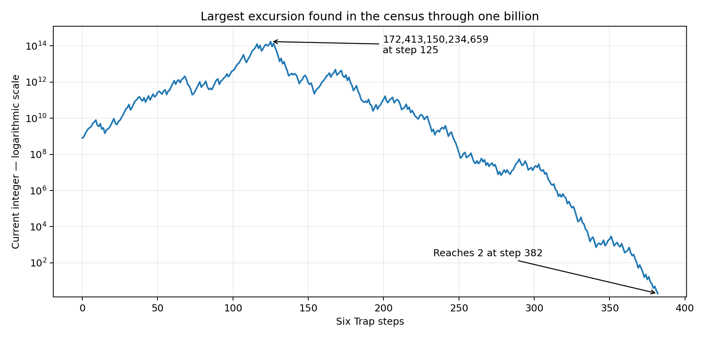

# Six Trap — Census Through One Billion

**Completed September 24, 2026. Exact integer arithmetic.**

Every integer from **2 through 1,000,000,000 inclusive** was classified: **999,999,999 starting values**, six discovered cycles, zero unclassified starts, and zero numerical or storage-cap hits.

This extends the archived exhaustive upper bound of 200,000,000 by **800,000,000 additional starting values**. The 200-million archival result was itself reexecuted during this turn; all six basin counts, its map-evaluation count, and its maximum orbit value matched the saved log exactly.

## 1. Exact rule and measurements

For n >= 2, D(n) is its largest positive proper divisor, and T(n) = n + D(n) - D(n+1). Both divisors are evaluated at the original n.

**Stopping time** counts applications before first reaching any member of the eventual cycle. It does not count the additional travel to the cycle’s minimum representative. **Orbit height** includes the seed, the whole transient, and all states of the eventual cycle.

## 2. Exhaustive basin census

| Cycle minimum | Period | Cycle maximum | Starts reaching it | Share of tested starts |
|---:|---:|---:|---:|---:|
| 2 | 1 | 2 | 948,084,782 | 94.808478% |
| 3,286 | 5 | 7,063 | 19,551,309 | 1.955131% |
| 4,210 | 9 | 14,849 | 25,946,998 | 2.594700% |
| 5,182 | 3 | 8,983 | 4,372,632 | 0.437263% |
| 54,214 | 4 | 106,891 | 350,595 | 0.035060% |
| 127,330 | 64 | 4,546,157 | 1,693,683 | 0.169368% |
| **Total** | | | **999,999,999** | **100%** |

These are finite-range proportions. They are not claims about limiting densities over all positive integers.

## 3. Records in the completed interval

### Longest transient

**623 steps**, first attained at seed **804,497,890**. Its eventual cycle has minimum **2**, and its complete orbit height is **38,439,384,979**.

### Largest absolute excursion

Seed **789,535,970** reaches **172,413,150,234,659** at step **125**, then first enters the cycle with minimum **2** at step **382**.

The peak is **218,372.761705 times** this starting value.

### Largest peak-to-start ratio

The exact ratio record is **172,413,150,234,659 / 789,535,970 = 218,372.761705**. It first occurs at seed **789,535,970**, which enters cycle **2** after **382** steps.

“Record” here means a record within this completed experiment, not a surveyed world record.

## 4. Stopping-time and neighbor statistics

- Mean steps to first cycle entry: **152.725997**.
- Median: **148** steps; 90th percentile: **207**; 99th percentile: **271**; 99.9th percentile: **332**.
- Adjacent starting values entering different cycles: **100,029,227 of 999,999,998 pairs**, or **10.002923%**.

Neighbor sensitivity here is this explicit finite statistic; it is not a proof of chaos, cryptographic unpredictability, or universality.

## 5. What was actually computed

The billion-range execution performed **1,495,346,614 map evaluations**. The sum of the individual seeds’ stopping times is **152,725,996,715**. Those are different counts: memoization reuses verified tails instead of recalculating each seed’s entire path.

The reported classification wall time, including construction of the factor sieve, was **887.938 seconds**. Subsequent verification and most serialization are outside that figure. These are measurements of this execution, not a controlled comparison with other problems or hardware.

The main arrays occupy roughly 3 GB. The scan uses exact least-prime-factor lookup within its sieve and exact trial division outside it. Cycles are discovered, not preloaded. No probabilistic primality test is used to accept a factorization.

Configured safeguards: orbit-value ceiling **10,000,000,000,000,000**, active-path ceiling **100,000**, stored distances below **4,096**, and at most 14 distinct cycle labels. **None was hit.**

## 6. Validation actually performed

A separately written internal verifier recomputed **120,057 selected starting-value classifications**, including every seed from 2 through 100,000, a deterministic broad-range sample, and all record seeds. It matched every expected cycle and stopping time. It discovered all six cycles independently and exported **113 full record trajectories** comprising **25,225 witnessed transitions**.

That verifier uses the direct formula and a different divisor calculation (trial division by 2, 3, and 6k +/- 1), not the primary sieve or its parity simplification. A separate Python audit checked all **86 cycle edges** by enumerating proper divisors and reconciled all seed totals, histograms, weighted step totals, and record fields.

The compact peak/ratio method was compared with full per-seed peak storage at ten million. The reusable source was additionally hardened for cycles wholly outside small dense-cache bounds. The exact source used for the retained billion run is included as `census_executed.cpp`; the hardening affects small-range reuse and does not alter any of the six observed billion-range cycles, all of which lie below the billion-range cache boundary.

**Scope limitation:** this is one full billion-range census with internal cross-checks, not two independent billion-range runs, outside peer review, or formal proof-assistant certification.

## 7. Comparison with reproduced earlier ranges

| Upper bound | Starts classified | Cycles | Longest transient | Maximum orbit value |
|---:|---:|---:|---:|---:|
| 10,000,000 | 9,999,999 | 6 | 404 | 26,033,578,997 |
| 200,000,000 | 199,999,999 | 6 | 534 | 3,574,570,438,763 |
| 1,000,000,000 | 999,999,999 | 6 | 623 | 172,413,150,234,659 |

Prior research reference: `Six-Trap_Conjecture_Log_through_Attack_10.md`, section “15 — The new numerical base: every start through 200 million.” Ten million and 200 million were already archived; neither is presented here as a newly discovered range.

## 8. What the result establishes—and what it does not

**Finite computational conclusion:** every integer from 2 through one billion reaches one of the same six explicitly checked cycles. In particular, any additional cycle would have to have every member above one billion; otherwise its tested member would not have entered one of these six.

**Not established:** convergence for every integer, absence of larger hidden cycles, absence of an escaping orbit from beyond the tested range, historical originality, cryptographic security, universal computation, a practical application, or a prize-worthy theorem.

This is a large computation **about Six Trap**. It does not demonstrate that Six Trap itself speeds up or solves an unrelated computation.

## 9. Reproduction and retained evidence

See `README.md` for compilation and reproduction commands. Machine-readable data are in `run_1000000000/summary.json`, `basins.csv`, `cycles.csv`, `stopping_time_histogram.csv`, the three record CSVs, and `verification_targets.csv`. Independent verification and complete record trajectories are in `verify_1000000000/`. Raw execution logs, the archive comparison, environment metadata, and SHA-256 checksums are retained.

Nothing was published, submitted, emailed, or uploaded back to the user’s Library as part of this computation.
